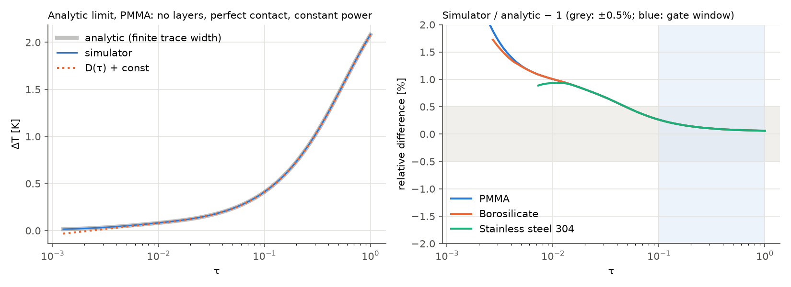
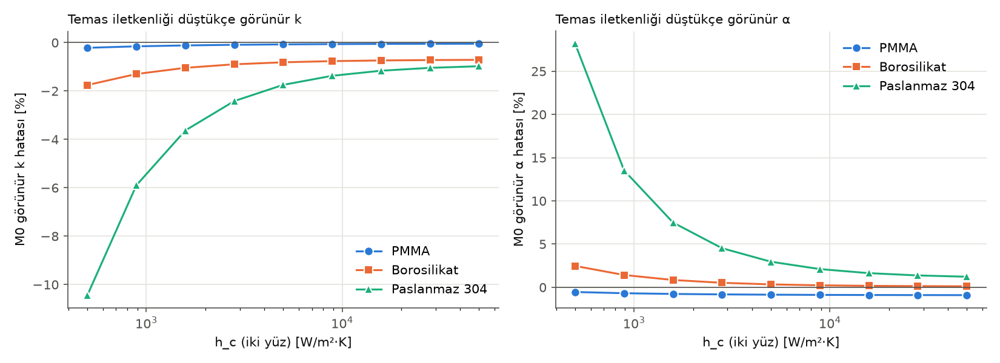
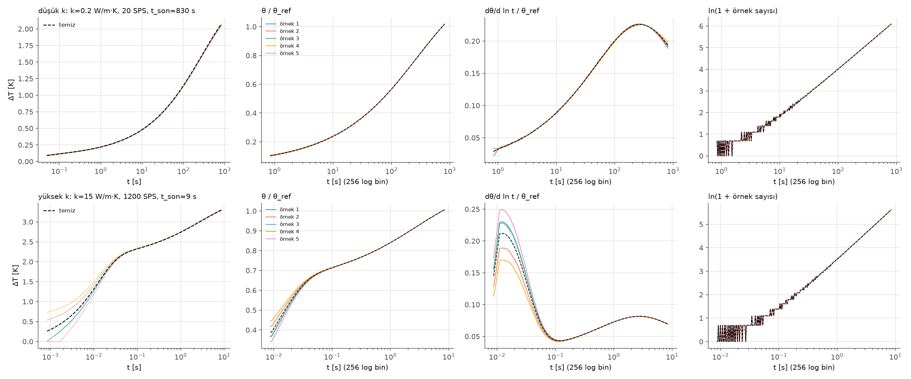
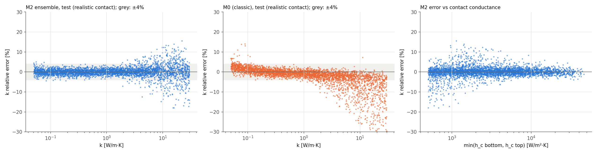
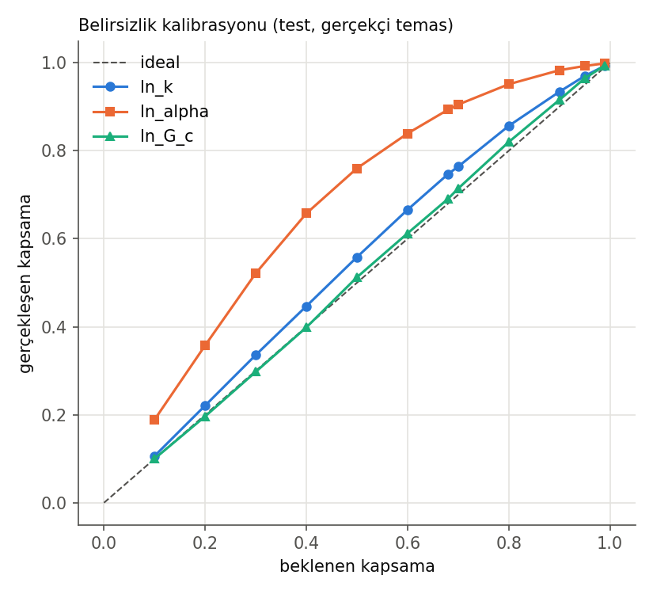
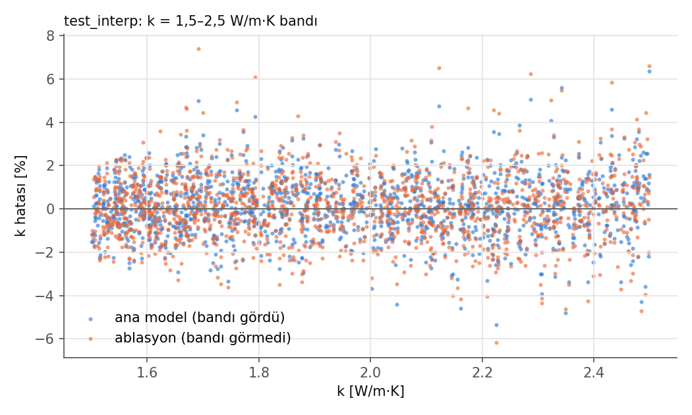
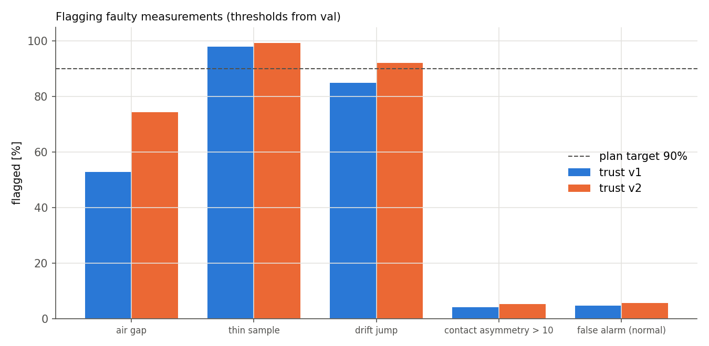

# Yapay Zekâ Destekli Hot-Disk (TPS) Isıl İletkenlik Ölçümü — Analiz Yazılımı ve Base Model Raporu (v1)

**Proje:** Düşük Maliyetli Yapay Zekâ Destekli Isıl İletkenlik Ölçüm Sistemi (İTÜ EHB bitirme projesi)
**Kapsam:** Simülatör, sentetik veri, klasik yöntem (M0) ve sinir ağı modeli (M2) — gerçek cihaz verisi öncesi
**Tarih:** 19 Ekim 2026 · **Kod sürümü:** git `a46546c` (tpslib 1.0.0) · **Model:** M2 v1

> **Önemli not.** Bu rapordaki bütün sayısal sonuçlar **simülasyona** dayanır. Gerçek cihaz verisiyle doğrulama henüz yapılmadı. Projenin başarı ölçütü (en az üç referans malzemede literatüre göre ≤ %15 hata) bu çalışmanın sonraki aşamasında, gerçek ölçümlerle değerlendirilecektir.

---

## Özet

Bu çalışmada düşük maliyetli bir hot-disk (Transient Plane Source, TPS) ısıl iletkenlik cihazının analiz yazılımı geliştirildi. Yazılım beş parçadan oluşuyor:

1. **Analitik referans ve klasik yöntem.** Gustafsson D(τ) fonksiyonu ve klasik TPS uydurması (M0). M0'a sabit akım altında değişen gücü hesaba katan bir genelleme eklendi.
2. **Fizik simülatörü.** İki numune ile ince film katmanlarını içeren eksenel simetrik (r–z) sonlu hacim simülatörü. Analitik sınır, ağ yakınsaması ve enerji korunumu kapılarından geçti.
3. **Sentetik veri.** Cihazın otomatik ayar kuralıyla üretilmiş 64.000 temiz sıcaklık eğrisi.
4. **Ölçüm zinciri modeli.** Gerçek cihaz kaydıyla birebir aynı biçimde gürültü, kayma, zamanlama ve kalibrasyon hatası üreten model; gerçek ve sentetik veri için ortak ön işleme.
5. **Sinir ağı (M2).** 5 üyeli bir 1B ResNet topluluğu. Isıl iletkenlik k, ısıl yayınım α ve sensör–numune temas iletkenliği G_c'yi belirsizlikleriyle birlikte tahmin ediyor.

Kilitli test setinde (gerçekçi temas koşullarında 3.715 örnek) M2, k için şu sonuçları verdi:

| k aralığı | Medyan hata | %95'lik hata |
|---|---|---|
| 0,05–0,5 W/m·K | %0,83 | %2,6 |
| 0,5–5 W/m·K | %0,89 | %3,2 |
| 5–30 W/m·K | %2,07 | %10,4 |

İlk iki aralıkta simülasyon hedefi (medyan < %1, %95'lik < %4) karşılandı. Klasik yöntemle karşılaştırma:
- Tüm aralıkta M2 k'da 2,3 kat, α'da 3,9 kat daha düşük %95'lik hata verdi.
- Klasik yöntemin yüksek k'da gösterdiği −%5'lik sistematik sapma M2'de görülmedi.

Belirsizlik tahminleri iyi kalibre (%95 aralık kapsaması %97). Eğitimde hiç görülmeyen bir k bandına genelleme kaybı ihmal edilebilir düzeyde. Cihaz için 62 bin parametrelik kompakt model büyük modelden yalnızca %0,27 (medyan) farklı. Model ONNX biçiminde dışa aktarıldı.

Başlıca sınırlar:
- Yüksek k bandındaki fiziksel zorluk.
- Güven sisteminin ilk sürümünün kötü temas durumlarını yeterince yakalayamaması.
- Ölçüm zinciri parametrelerinin henüz yer tutucu olması.

---

## 1. Giriş

### 1.1 Ölçüm ilkesi

Hot-disk yönteminde (ISO 22007-2), iki özdeş numune arasına sıkıştırılmış düzlemsel bir spiral sensör sabit akımla ısıtılır. Sensörün direnci sıcaklıkla doğrusal değiştiği için (R = R₀[1 + α_R·ΔT]) sensör aynı anda hem ısıtıcı hem termometredir. Ölçülen ortalama sıcaklık artışı ΔT(t) numunenin ısıl iletkenliği (k) ve ısıl yayınımıyla (α) belirlenir. İdeal koşullarda:

ΔT(τ) = P / (π^1,5 · a · k) · D(τ) + B,  τ = √(α t) / a

Burada a sensör yarıçapı, D(τ) Gustafsson'un boyutsuz fonksiyonu, B ise ince yalıtım katmanlarındaki sabit sıcaklık farkıdır. Klasik yöntem (M0), ΔT'yi D(τ)'ya karşı en doğrusal yapan α'yı arar ve doğrunun eğiminden k'yı hesaplar.

### 1.2 Neden bir model gerekiyor?

Gerçek bir sensörde ideal varsayımlar tam sağlanmaz:
- Kapton ve yapıştırıcı katmanlarının ısıl direnci ve ısı kapasitesi var.
- İki yüzde temas direnci farklı olabilir.
- Sabit akımda güç ısınmayla artar.
- Numune sonlu boyuttadır.
- Ölçümde gürültü ve ortam kayması bulunur.

Bu etkiler klasik yöntemde sistematik hatalara yol açar (bkz. 4.2 ve 4.6). Projenin yaklaşımı:
1. Bu fiziği içeren doğrulanmış bir simülatörle büyük ve çeşitli bir eğitim verisi üretmek.
2. Bu veriyle, belirsizlik de veren bir model eğitmek.
3. Sonraki aşamada modeli gerçek cihaz ölçümleriyle ayarlamak.

### 1.3 Sensör ve cihaz

| Özellik | Değer |
|---|---|
| Sensör | Flex PCB üzerinde bakır çift spiral, m = 20 halka, a = 6,4 mm, iz genişliği b = 0,10 mm, bakır kalınlığı 18 µm |
| Katmanlar | Alt: 25 µm poliimid (PI). Üst: 15 µm yapıştırıcı + 12,5 µm PI. **İki taraf simetrik değil.** |
| Elektrik | R₀ ≈ 4 Ω, α_R ≈ 0,0039 1/K |
| Cihaz | ADS1263 (32 bit, oranlı ölçüm), iki akım aralığı, 8 mW–1 W güç, 20–1200 örnek/s |
| Numuneler | İki özdeş parça; yarıçap 20–30 mm, kalınlık 8–25 mm |

Tüm sabitlerin tek doğruluk kaynağı `configs/sensor.yaml` ve `configs/device.yaml` dosyalarıdır.

---

## 2. Yöntem

### 2.1 Analitik D(τ) ve klasik uydurma (M0)

**D(τ):** Halka kaynakları üzerinden sayısal integral olarak hesaplandı. Taşmayı önlemek için ölçekli Bessel fonksiyonu (`i0e`) kullanıldı. Hızlı kullanım için ln σ ızgarasında Simpson integrali ve kübik spline tablosu kuruldu; tablonun doğrudan hesaptan farkı 3·10⁻¹³.

**Bulgu — integralin alt sınırı.** Sonsuz ince halkaların kendi üzerindeki sıcaklığı sonsuz olduğundan D(τ) integrali σ → 0'da logaritmik olarak ıraksar. Literatürdeki tablo değerleri belirli bir alt sınırla (σ_min = 10⁻⁶) üretilmiş; bizim referans değerlerimiz de tam bu sınırla tutuyor. Alt sınır D'ye yalnızca sabit bir terim ekler. Bu terim uydurmada B'ye gider ve k ile α'yı etkilemez (testle doğrulandı). Ancak mutlak "ideal" ΔT fiziksel bir büyüklük değildir. Bu yüzden simülatör doğrulamasında sonlu iz genişlikli analitik bir referans kullanıldı (bkz. 2.2).

**M0, sabit akıma genelleştirildi.** Sabit akımda güç P(t) = I²R₀(1 + α_R·ΔT) ısınmayla yaklaşık %1 artar. M0 modeli şu biçimde kuruldu:

ΔT(t) = A · D̃(t) + B · P(t)/P₀,  D̃(t) = Σⱼ (ΔPⱼ/P₀) · D(τ(t − tⱼ))

Burada D̃, güç geçmişine göre Duhamel ilkesiyle ağırlıklandırılmış D'dir. α taraması iki aşamalı: önce kaba log tarama, sonra pencere sabitken tek boyutlu en küçükleme; pencere değişmeyene kadar tekrar. Uydurma penceresi 0,3 < τ² < 1.

### 2.2 Simülatör

**Geometri ve fizik:**
- Eksenel simetrik r–z sonlu hacim modeli: alt ve üst numune, aralarında dört film katmanı (PI taban | bakır seviyesi | yapıştırıcı | PI örtü).
- Film katmanları toplu ısıl direnç ve ısı kapasitesi olarak modellendi; bakır seviyesinde izlerde bakır, izler arasında yapıştırıcı var.
- Her yüzde ayrı temas iletkenliği (h_c) tanımlı. Film dışında (r > 10 mm) numuneler arasında hava boşluğu, dış yüzeylerde zayıf taşınım (10 W/m²·K) var.

**Kaynak ve okuma:**
- Joule ısısı bakır hacmine düzgün dağılıyor, yani halka gücü halka uzunluğuyla orantılı.
- Sensör okuması halka sıcaklıklarının uzunlukla ağırlıklı ortalaması; bu, 4 telli direnç ölçümünün tam karşılığı.
- Sabit akım geri beslemesi zaman adımı içinde kapalı (implicit) çözülüyor (Sherman–Morrison).

**Ağ (kapsamlı bir ağ çalışmasının sonucu):**
- **Bakır iz kenarı sınır tabakası.** Bakır iz kenarında, komşu yapıştırıcı ve PI'ye yanal ısı sızıntısından doğan ~20 µm'lik bir sınır tabakası bulundu. İz başına tek hücreli kaba ağ bu tabakayı çözemiyor ve ΔT'de büyük bir sabit kayma yaratıyor: PMMA'da %1,5, paslanmaz çelikte %15. Çözüm, her iz kenarında 1,5 µm genişliğinde hücre ve kenardan uzaklaştıkça geometrik büyüme.
- **İki bölgeli ağ.** İnce radyal sütunlar yalnızca sensör düzleminin 0,3 mm yakınında, uzakta kaba sütunlar. İki bölge doğrusal interpolasyonlu, simetrik ve enerji korunumlu bir arayüzle bağlı. İlk denenen parçalı sabit arayüz k'da %1–5 hata verdiği için reddedildi.
- **Uzak alan.** Geç zaman şekli, dolayısıyla α, uzak alandaki büyüme oranlarına duyarlı; bu oranlar 1,05 seçildi.

**Zaman şeması:**
- TR-BDF2 (γ = 2 − √2; L-kararlı, 2. mertebe). İki aşaması aynı matrisi kullandığı için seviye başına tek LU ayrıştırması ve adım başına iki geri çözüm yetiyor.
- İlk seviye, güç basamağının sert modlarını sönümlemek için Richardson ekstrapolasyonlu kapalı Euler ile çözülüyor.
- Adım boyu her 12 adımda ikiye katlanıyor.

**Doğrulama kapıları:**
1. Analitik sınır: sonlu iz genişlikli bant çözümüyle (Hankel dönüşümü, tam ifade) karşılaştırma.
2. Yakınsama: ağ ve zaman adımı yarıya indirildiğinde değişim.
3. Enerji korunumu.
4. Fiziksel davranış: temas, numune kalınlığı, film katmanları.
5. Hız.

### 2.3 Prior, otomatik ayar kuralı ve veri üretimi

**Parametre aralıkları (bağımsız örneklendi):**

| Parametre | Aralık | Dağılım |
|---|---|---|
| k | 0,05–30 W/m·K | log-düzgün |
| ρc_p | 0,8–4,5 MJ/m³·K | düzgün (α = k/ρc_p) |
| h_c (alt ve üst ayrı) | 500–50.000 W/m²·K | log-düzgün |
| Katman kalınlıkları | nominal ±%20 | düzgün |
| PI ve yapıştırıcı k'sı | 0,12–0,25 W/m·K | düzgün |
| Numune | yarıçap 20–30 mm, kalınlık 8–25 mm | düzgün |
| Kalibrasyon hataları | α_R σ %1, yarıçap σ %0,5 | normal |

**Otomatik ayar kuralı (cihaz firmware'iyle aynı mantık).** ±%30 hatalı bir yoklama tahmininden:
- Güç: τ = 1'de 2,5 K hedefi, 8 mW–1 W'a kırpılır.
- Süre: τ = 1 ya da ilerleme derinliğinin numune boyutunun %90'ına ulaştığı an, hangisi önce gelirse.
- Veri hızı: kayıt başına 12.000 örnek bütçesiyle.
- Akım aralığı: L/H.

Güç ve süre bu kuraldan gelir, bağımsız rastgele seçilmez.

**Bölmeler:** ayrı tohumlarla üretildi.

| Bölme | Örnek | Not |
|---|---|---|
| train | 50.000 | |
| val | 5.000 | model seçimi |
| test | 5.000 | yalnızca en sonda |
| test_interp | 2.000 | k = 1,5–2,5 bandı |
| test_faulty | 2.000 | hava boşluğu, ince numune, kayma sıçraması |

**Üretim:** çok süreçli, yarıda kalırsa kaldığı yerden devam eden, HDF5 parçalarına yazan ve her parçayı Drive'a yedekleyen bir hat. 64.000 simülasyonun tamamı hatasız tamamlandı. Paralel üretimin darboğazı bellek bant genişliğiydi; üretim, 44 CPU çekirdekli bir Colab çalışma zamanında yapıldı.

### 2.4 Ölçüm zinciri, ortak ön işleme ve özellikler

**Ölçüm etkileri** eğitim sırasında, cihazın ham kayıt biçiminde eklenir: ADC oranı, akım, ön ölçümden R₀ ve kayma eğimi. Eklenenler (`configs/device.yaml`; şu an veri sayfası tabanlı yer tutucu değerler):

| Etki | Model |
|---|---|
| ADC gürültüsü | Beyaz + 1/f; 0,23 µV × √(SPS/20), gerçek kart için 1–2 kat |
| Ortam kayması | ±0,2 mK/s doğrusal + küçük kuadratik; ön ölçümde eğim tahmin hatası |
| Zaman | Isıtma başlangıcı kayması t_c ±5 ms, saat hatası |
| Güç | ±%0,5 güç hatası |
| Elektronik | Elektronik kayma ve düzeltme artığı |
| Kalibrasyon | α_R ve yarıçap kalibrasyon hataları |

**Ortak ön işleme.** Gerçek ve sentetik veri aynı fonksiyondan geçer: oran → direnç → ΔT → kayma ve elektronik düzeltme → P = I²R.

**Özellikler:**
- 256 noktalı log-zaman ızgarası.
- Kanallar: θ/θ_ref, dθ/d ln t/θ_ref ve bin başına örnek sayısı (θ = ΔT·π^1,5·a/P).
- 7 skaler girdi.

θ, k ile 600 kat değiştiği için genliği ayrı bir skalerde (ln θ_ref) taşımak, bilgi kaybetmeden sayısal koşullanmayı iyileştirir.

### 2.5 Model (M2) ve eğitim

| Bileşen | Seçim |
|---|---|
| Mimari | 1B ResNet: 4 blok (32–64–128–128 kanal, çekirdek 5, GELU), global ortalama havuzlama, skalerlerle birleşen 128 nöronlu baş; 375.078 parametre |
| Çıktı | ln k, ln α, ln G_c için ortalama ve log-varyans |
| Kayıp | β-NLL (β = 0,5); hedef ağırlıkları 1 / 0,5 / 0,2 |
| Optimizasyon | AdamW (1e-3, ağırlık azalması 1e-4), 2 epok ısınma + kosinüs, yığın 256, 60 epok, gradyan kırpma 1,0, karışık hassasiyet (CUDA) |
| Erken durdurma | val ln k NLL, sabır 8, 30. epoktan önce devre dışı |
| Topluluk | 5 tohum; her üyenin ölçüm etkisi tohumu da farklı |
| Kompakt model | 16–32–48–48 kanal, 61.910 parametre, 2 üye |

**Temas asimetrisi kararı.** Val üzerindeki teşhis, yüksek k'daki büyük hataların iki yüzün temas kalitesinin 10 kattan fazla farklı olduğu örneklerden geldiğini gösterdi. Bu örneklerde k %20–30 düşük tahmin ediliyordu. Gerçek fikstürde iki yüz aynı kuvvetle sıkıştığı için bu kadar fark ancak bir arızada beklenir. Proje kararıyla h_c,maks/h_c,min > 10 arıza sayıldı ve eğitim alanından çıkarıldı (37.604 eğitim örneği). Bu karar gerçekçi temas alanında yüksek k'nın %95'lik hatasını ~%13'ten ~%9'a, α'nın medyan hatasını %3,7'den %1,5'e indirdi.

### 2.6 Değerlendirme protokolü ve sızıntı önlemleri

- Bölmeler ayrı tohumlarla üretildi; aynı parametre örneğini paylaşmazlar.
- Normalizasyon istatistikleri yalnızca train'den hesaplandı; kod, başka bölmeden hesaplamayı engelliyor.
- Model seçimi ve tüm eşikler yalnızca val ile yapıldı. Test setleri değerlendirmede **bir kez** kullanıldı. Güven sistemi v2'nin yeniden değerlendirmesi ikinci kullanım olarak açıkça etiketlenecek.
- Ölçüm etkileri val ve test'te örnek başına sabit tohumla üretildi; sonuçlar tekrarlanabilir.

---

## 3. Doğrulama sonuçları (Faz 1–4)

### 3.1 Analitik çözüm ve M0 (Faz 1)

| Kontrol | Sonuç |
|---|---|
| D(τ), 6 referans değer | en büyük sapma %0,0007 |
| M0, gürültüsüz analitik eğriler, 20 k değeri (0,05–30) | k ≤ %0,003, α ≤ %0,019 (sabit akım dahil) |
| Sabit akımdaki güç artışı yok sayılırsa | k %0,66–0,73, α %1,9–2,2 sistematik hata |

Son satır, cihazın sabit akımla ölçmesi nedeniyle güç değişiminin analizde hesaba katılmasının zorunlu olduğunu gösteriyor. Grafikler: `reports/phase1/`.

### 3.2 Simülatör (Faz 2)

| Kapı | Hedef | Sonuç |
|---|---|---|
| Analitik sınır (0,1 ≤ τ ≤ 1) | %0,5 | %0,26 |
| Ağ ve adım yarıya indirildiğinde değişim | %0,1 | %0,093–0,099; M0 k ≤ %0,019, α ≤ %0,042 |
| Enerji korunumu | %0,5 | makine hassasiyeti (~10⁻¹⁶) |
| Fiziksel davranış | görünür | h_c ↓ → görünür k ↓ (monoton); ince numunede geç sapma; film katmanlarının erken zaman etkisi |
| Hız | < 1 s | 2,1–2,6 s (tek çekirdek); doğruluk tercih edildi |

**Fiziksel bulgular.** Klasik M0 gerçekçi koşullarda sistematik hata yapar:

| Durum | M0 k hatası | M0 α hatası |
|---|---|---|
| PMMA, h_c = 5000 | −%0,07 | −%0,9 |
| Borosilikat, h_c = 5000 | −%0,8 | +%0,3 |
| Paslanmaz çelik, h_c = 5000 | −%1,7 | +%3,0 |
| Paslanmaz çelik, h_c = 500 | −%10 | +%28 |
| PMMA, 12 mm numune | +%0,9 | −%12 |

### 3.3 Veri (Faz 3)

| Özellik | Sonuç |
|---|---|
| Üretim | 64.000/64.000 simülasyon başarılı; ayrık enerji dengesi < 10⁻¹⁰ |
| Pilot (1.000 örnek) ΔT_max | medyan 2,56 K, %5–95 aralığı 1,58–5,24 K |
| Gücü 1 W'ta kırpılan örnekler | %21 (k ≳ 7 W/m·K) |
| Süresi numune boyutuyla sınırlanan ölçümler | %43 |

Grafikler: `reports/phase3/`.

### 3.4 Ölçüm zinciri (Faz 4)

| Kontrol | Sonuç |
|---|---|
| Gürültüsüz zincirin tersine çevrilmesi | 10⁻⁷ K (tam) |
| M0, ideal eğri + ölçüm etkileri (20 k × 5 tekrar) | k ≤ %0,70; kalibrasyon hatalarıyla ≤ %1,59 (kapı %2) |

Etkilerin tek tek katkısına bakıldığında α'yı uzun ve düşük k'lı ölçümlerde **ortam kayması** belirliyor: 820 s'lik bir ölçümde %10'a kadar.

---

## 4. Model sonuçları (Faz 5–6)

### 4.1 Eğitim

5 topluluk üyesi val setinde birbirine çok yakın sonuç verdi (gerçekçi temas alanı):

| Ölçüt | Aralık |
|---|---|
| k medyan hata | %1,05–1,12 |
| k %95'lik hata | %6,1–6,4 |
| α medyan hata | %1,0–1,5 |
| %95 aralık kapsaması | 0,96 |

Eğitim kararlı.

### 4.2 Kilitli test seti: doğruluk

Gerçekçi temas alanı, n = 3.715. Hücreler: k medyan / %95'lik hata.

| k aralığı [W/m·K] | M2 topluluk | M0 (klasik) | M2 α (medyan / %95) | Hedef (%1 / %4) |
|---|---|---|---|---|
| 0,05–0,5 | **%0,83 / %2,60** | %1,21 / %3,65 | %0,71 / %2,47 | ✔ |
| 0,5–5 | **%0,89 / %3,17** | %1,41 / %6,39 | %0,92 / %6,81 | ✔ |
| 5–30 | **%2,07 / %10,36** | %5,03 / %23,86 | %2,78 / %9,32 | ✘ |
| Tümü | %1,01 / %5,85 | %1,71 / %13,47 | %1,03 / %7,32 | — |

**Kaldırılamaz taban.** Kalibrasyon hataları (α_R σ %1, yarıçap σ %0,5) ve güç hatası eğriden görülemez. Yalnız bunlar k'da ~%0,77 medyan ve ~%2,3 %95'lik hata oluşturur. k < 5 bandında M2 bu tabana çok yaklaşmıştır.

### 4.3 Belirsizlik kalibrasyonu

| Hedef | %68 aralığı içerme oranı | %95 aralığı içerme oranı |
|---|---|---|
| ln k | %74,7 | %97,0 |
| ln α | %89,3 | %99,3 |
| ln G_c | %69,1 | %96,4 |

- G_c neredeyse ideal kalibre, k hafif temkinli.
- α belirgin temkinli: bildirilen aralık gerçek hatadan geniş.
- Güven sistemi v2'de val üzerinden bir varyans ölçeği eklendi (bkz. 4.6).

### 4.4 Görülmemiş k aralığına genelleme (ablasyon)

k = 1,5–2,5 W/m·K bandı eğitimden ve val'dan çıkarılarak ayrı bir model eğitildi. Bu model o bantta k medyan %0,92, %95'lik %2,91 hata verdi; bandı gören model %0,86 / %2,58. Belirsizliği de kalibre kaldı (%95 kapsama %96). Yani model eğitim verisini ezberlemiyor; ara değerlere başarıyla genelliyor. Bu, yeni malzemeler için önemli bir bulgu.

### 4.5 Kompakt cihaz modeli ve dışa aktarma

| Model | Parametre | k medyan / %95 | Toplulukla fark (medyan / %99) |
|---|---|---|---|
| Topluluk | 5 × 375.078 | %1,01 / %5,85 | — |
| Kompakt | 2 × 61.910 | %1,08 / %6,14 | %0,27 / %2,1 |

Topluluk normalizasyonlarıyla birlikte tek bir ONNX grafiğine aktarıldı (7,6 MB). PyTorch ile en büyük fark 2·10⁻⁶.

### 4.6 Hatalı ölçümlerin işaretlenmesi (güven sistemi)

**v1:** eşikler val'ın %99'luk dilimlerinden. Kontroller: topluluk farkı, toplam belirsizlik, M0–M2 farkı, M0 artığı, ΔT aralığı.

| Durum | İşaretlenen (v1) | v2 |
|---|---|---|
| İnce numune (yanlış girilen kalınlık) | %97,9 | koşu bekleniyor |
| Kayma sıçraması | %84,9 | koşu bekleniyor |
| Hava boşluğu | **%52,8** | koşu bekleniyor |
| Temas asimetrisi > 10 | **%4,2** | koşu bekleniyor |
| Normal ölçümde yanlış alarm | %4,7 | koşu bekleniyor |

v1'de işaretlenmeyen arızalı ölçümlerde k medyan %14 düşük çıkıyor. Bu yüzden güven sistemi v2 geliştirildi (model yeniden eğitilmeden):
- Tahminlerin eğitim aralığında olup olmadığı kontrolü.
- Her hedef için topluluk farkı.
- Ortak yanlış alarm bütçesi.
- Val'dan varyans ölçeği.

v2'nin sayısal sonuçları Colab'da tek bir değerlendirme koşusu bekliyor (`docs/COLAB.md`). Yeniden simülasyonlu ters çözüm (M0+) tasarlandı (`docs/M0PLUS.md`); asimetrik temasın asıl çözümü olması bekleniyor.

---

## 5. Tartışma

**Güçlü yanlar:**
- **Fiziksel doğruluk önce geldi.** Simülatör, sonlu iz genişlikli analitik çözüme %0,26 içinde uyuyor ve ağ ile zaman adımına göre yakınsamış durumda (%0,1). Bakır iz kenarındaki sınır tabakası ve uzak alanın α'ya etkisi gibi bulgular, kaba bir simülatörün yüksek k'da %15'lik sahte bir kayma üreteceğini gösterdi.
- **Ana referans setinde model darboğaz değil.** PMMA, PTFE ve camın bulunduğu k < 5 aralığında M2 kaldırılamaz tabana çok yakın. Gerçek cihazda doğruluğu α_R kalibrasyonu, güç ölçümü, temas ve referans değerlerin kendi belirsizliği (%5–10) belirleyecek. Bu, projenin %15 hedefine karşı rahat bir pay demek.
- **Klasik yöntemin sistematik sapmaları giderildi.** Film ve temas kaynaklı sapmalar (düşük k'da +%2–3, yüksek k'da −%5 ile −%30) M2'de yok. Bu, yapay zekâ yaklaşımının asıl katkısı.
- **Sızıntıya karşı disiplin.** Ayrı tohumlu bölmeler, yalnızca train'den normalizasyon, eşiklerin yalnızca val'dan seçilmesi ve tek kullanımlık test setleri.

**Zayıf yanlar ve dürüst değerlendirme:**
- **Yüksek k (5–30 W/m·K).** %95'lik hata %10. Güç 1 W'ta kırpılıyor ve sinyalin çoğu sensörün kendi katmanlarından geliyor. Planın doğrulanmış aralığının 16 W/m·K'de bitmesiyle tutarlı. Daha ince yalıtım ya da daha yüksek güç gibi donanım iyileştirmeleri bu bandı iyileştirebilir.
- **Güven sistemi henüz tam değil.** Kötü ve asimetrik temas yeterince yakalanmıyor. Gerçek ölçüme geçmeden önce v2 sonuçlarının doğrulanması ve M0+'nın uygulanması gerekiyor.
- **Ölçüm zinciri parametreleri yer tutucu.** Gürültü, kayma, t_c ve elektronik kayma gerçek cihaz kayıtlarıyla güncellenecek. Bunlar eğitim sırasında eklendiği için **veri yeniden üretilmeden** yeniden eğitimle güncellenebilir.
- **Temas dağılımı varsayımı.** "Asimetri > 10 arızadır" kararı fiziksel bir varsayım. Gerçek temas dağılımı ilk ölçümlerden öğrenildiğinde veri v2 ile gözden geçirilecek.

---

## 6. Sonraki adımlar

1. **Güven sistemi.** v2 değerlendirme koşusu, ardından M0+ (yeniden simülasyon artığı ve iki yüzün ayrı temas kestirimi).
2. **Donanım** (plan İP1–İP4):
   - Sensör tasarımının dondurulup sipariş edilmesi.
   - Ölçüm zincirinin devreye alınması (T1–T4).
   - Fikstür.
3. **Simülasyondan gerçeğe geçiş** (plan 9.7):
   - Boşta ve sahte yük kayıtları → `device.yaml`.
   - PMMA ve camda ilk ölçümler → simülatörün gerçek eğriyi artık bırakmadan üretip üretmediği ve gerçek temas dağılımı.
   - Gerekirse veri v2 ve yeniden eğitim.
4. **Gerçek veri seti ve ince ayar:**
   - 5–6 malzeme × 30–40 ölçüm; etiketler ticari bir cihazla ölçtürülmüş değerler.
   - Malzeme düzeyinde çapraz doğrulama ve kilitli test malzemeleriyle son test (plan T8–T9).
5. **Ürün:** kompakt modelin cihaza taşınması, masaüstü ve mobil uygulama, demo.

---

## Ek A. Tekrarlanabilirlik

| Öğe | Yer |
|---|---|
| Kod | git `a46546c` (tpslib 1.0.0); testler: `python -m pytest -q` (147 test) |
| Ayarlar | `configs/*.yaml` (SI birimleri); veri v1 manifest'i config özetlerini, tohumları ve kod özetini içerir |
| Tohumlar | Bölmeler 1001 / 2002 / 3003 / 4004 / 5005. Ölçüm etkisi tohumları `dataset_v1.yaml → effect_seeds`. Topluluk tohumları 1–5. |
| Simülatör doğrulama | `python scripts/validate_sim.py` |
| Veri üretimi | `python scripts/generate_dataset.py --splits train val test test_interp test_faulty` |
| Eğitim | `python scripts/train_m2.py --seeds 1 2 3 4 5 --tag v1sym --max-asym 10` |
| Değerlendirme | `python scripts/evaluate.py --ensemble-tag v1sym --seeds 1 2 3 4 5 --ablation ablation_m2_seed1 --compact-tag v1c --compact-seeds 1 2 --max-asym 10` |
| Model dosyaları | Depoda değil (gizli): Drive `tps-meter/runs/`, `tps-meter/phase6_bundle.zip` |
| Ayrıntılı faz raporları | `reports/phase0.md` … `reports/phase6.md`; kararlar `docs/DECISIONS.md` |

## Ek B. Terimler

| Terim | Anlam |
|---|---|
| TPS / hot-disk | Düzlemsel spiral sensörle geçici ısıl ölçüm yöntemi |
| k | Isıl iletkenlik [W/m·K] |
| α | Isıl yayınım [m²/s], α = k/ρc_p |
| τ | Boyutsuz zaman √(αt)/a |
| D(τ) | Gustafsson'un boyutsuz sıcaklık fonksiyonu |
| h_c, G_c | Bir yüzün temas iletkenliği; bakırdan iki numuneye toplam arayüz iletkenliği [W/m²·K] |
| M0 | Klasik TPS uydurması |
| M0+ | Simülatörle tam fizik ters çözümü (tasarlandı) |
| M2 | Sinir ağı topluluğu |
| %95'lik hata | Mutlak bağıl hataların %95'inin altında kaldığı değer |
| Kapsama | Bildirilen belirsizlik aralığının gerçek değeri içerme oranı |
| Ablasyon | Bir bileşen ya da veri bölümü çıkarılarak yapılan karşılaştırma deneyi |
