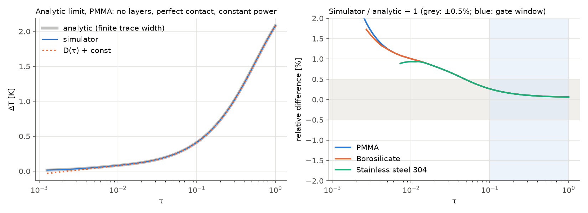
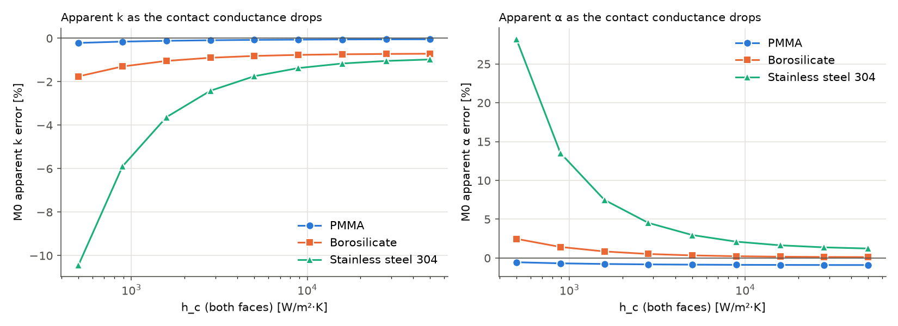
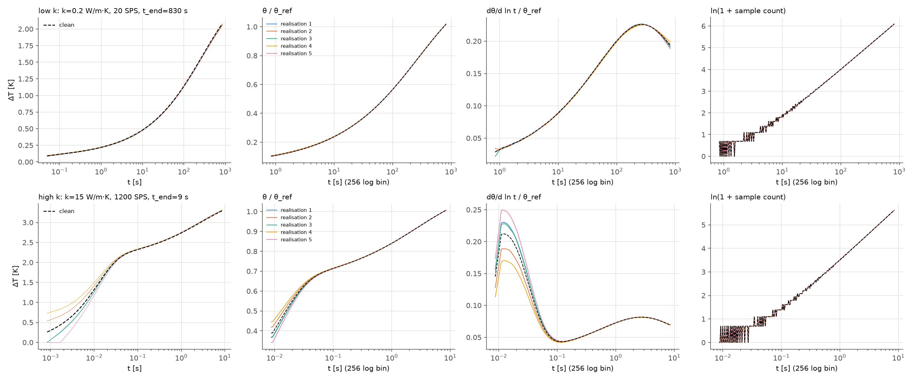
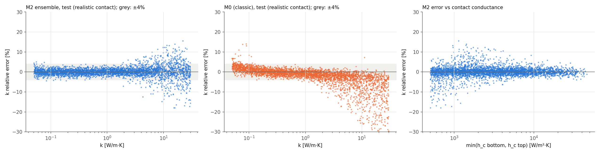
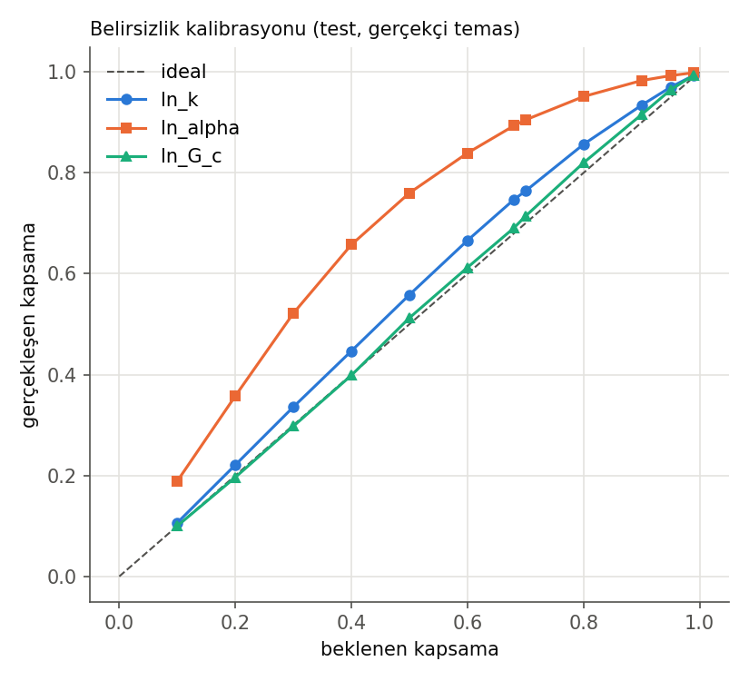
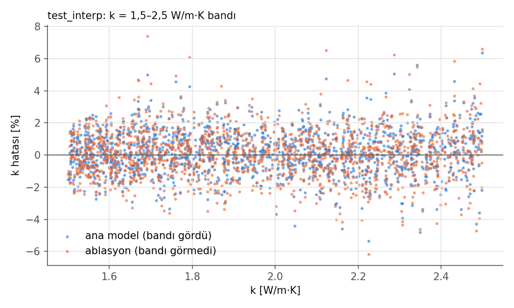
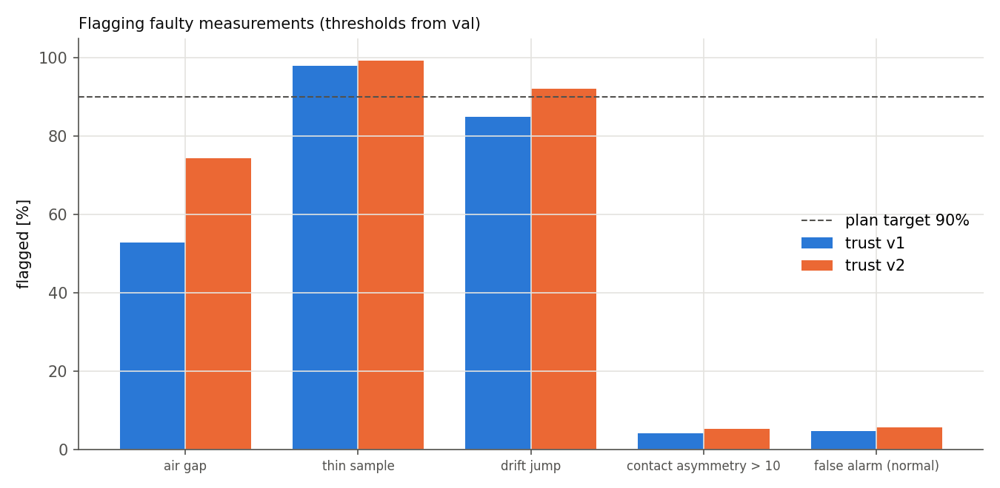

# AI-Assisted Hot-Disk (TPS) Thermal Conductivity Measurement — Analysis Software and Base Model Report (v1)

**Project:** Low-Cost AI-Assisted Thermal Conductivity Measurement System (ITU EHB graduation project)
**Scope:** Simulator, synthetic data, classic method (M0) and neural network model (M2) — before real device data
**Date:** 19 October 2026 · **Code version:** git `a46546c` (tpslib 1.0.0) · **Model:** M2 v1

> **Important note.** All numerical results in this report are based on **simulation**. Validation with real device data has not been done yet. The project's success criterion (≤ 15% error against the literature on at least three reference materials) will be evaluated in the next stage of this work, with real measurements.

---

## Summary

This work developed the analysis software of a low-cost hot-disk (Transient Plane Source, TPS) thermal conductivity device. The software has five parts:

1. **Analytic reference and classic method.** Gustafsson's D(τ) function and the classic TPS fit (M0). M0 was extended to account for the power that changes under constant current.
2. **Physics simulator.** An axisymmetric (r–z) finite-volume simulator including the two samples and the thin film layers. It passed the analytic-limit, mesh-convergence and energy-conservation gates.
3. **Synthetic data.** 64,000 clean temperature curves generated with the device's auto-setup rule.
4. **Measurement-chain model.** A model that produces noise, drift, timing and calibration errors in exactly the same format as a real device record; shared preprocessing for real and synthetic data.
5. **Neural network (M2).** A 5-member 1D ResNet ensemble. It estimates the thermal conductivity k, the thermal diffusivity α and the sensor–sample contact conductance G_c, each with an uncertainty.

On the locked test set (3,715 samples under realistic contact conditions) M2 gave these results for k:

| k range | Median error | p95 error |
|---|---|---|
| 0.05–0.5 W/m·K | 0.83% | 2.6% |
| 0.5–5 W/m·K | 0.89% | 3.2% |
| 5–30 W/m·K | 2.07% | 10.4% |

In the first two ranges the simulation target (median < 1%, p95 < 4%) was met. Compared with the classic method:
- Over the whole range M2 gave a 2.3× lower p95 error for k and 3.9× lower for α.
- The −5% systematic bias of the classic method at high k was not seen in M2.

The uncertainty estimates are well calibrated (95% interval coverage 97%). The loss from generalising to a k band never seen in training is negligible. The 62k-parameter compact model for the device differs from the large model by only 0.27% (median). The model was exported in ONNX format.

Main limitations:
- The physical difficulty in the high-k band.
- The first version of the trust system does not catch poor-contact cases well enough.
- The measurement-chain parameters are still placeholders.

---

## 1. Introduction

### 1.1 Measurement principle

In the hot-disk method (ISO 22007-2), a planar spiral sensor clamped between two identical samples is heated with a constant current. Because the sensor's resistance changes linearly with temperature (R = R₀[1 + α_R·ΔT]), the sensor is both heater and thermometer. The measured mean temperature rise ΔT(t) is determined by the sample's thermal conductivity (k) and thermal diffusivity (α). Under ideal conditions:

ΔT(τ) = P / (π^1.5 · a · k) · D(τ) + B,  τ = √(α t) / a

Here a is the sensor radius, D(τ) Gustafsson's dimensionless function, and B the constant temperature difference across the thin insulating layers. The classic method (M0) searches for the α that makes ΔT most linear in D(τ) and computes k from the slope of the line.

### 1.2 Why a model is needed

In a real sensor the ideal assumptions do not hold exactly:
- The Kapton and adhesive layers have thermal resistance and heat capacity.
- The contact resistance can differ between the two faces.
- At constant current the power rises as the sensor heats.
- The sample has a finite size.
- The measurement has noise and ambient drift.

These effects cause systematic errors in the classic method (see 4.2 and 4.6). The project's approach:
1. Generate a large and varied training set with a validated simulator that includes this physics.
2. Train a model on these data that also gives an uncertainty.
3. In the next stage, adjust the model with real device measurements.

### 1.3 Sensor and device

| Property | Value |
|---|---|
| Sensor | Copper double spiral on flex PCB, m = 20 rings, a = 6.4 mm, trace width b = 0.10 mm, copper thickness 18 µm |
| Layers | Bottom: 25 µm polyimide (PI). Top: 15 µm adhesive + 12.5 µm PI. **The two sides are not symmetric.** |
| Electrical | R₀ ≈ 4 Ω, α_R ≈ 0.0039 1/K |
| Device | ADS1263 (32-bit, ratiometric), two current ranges, 8 mW–1 W power, 20–1200 samples/s |
| Samples | Two identical pieces; radius 20–30 mm, thickness 8–25 mm |

The single source of truth for all constants is `configs/sensor.yaml` and `configs/device.yaml`.

---

## 2. Method

### 2.1 Analytic D(τ) and the classic fit (M0)

**D(τ):** computed as a numerical integral over the ring sources. The scaled Bessel function (`i0e`) was used to avoid overflow. For fast use a table was built with Simpson integration on a ln σ grid and a cubic spline; the table differs from the direct computation by 3·10⁻¹³.

**Finding — lower limit of the integral.** Because the self-temperature of infinitely thin rings is infinite, the D(τ) integral diverges logarithmically as σ → 0. The table values in the literature were produced with a specific lower limit (σ_min = 10⁻⁶); our reference values match exactly with this limit. The lower limit only adds a constant term to D. In the fit this term goes into B and does not affect k or α (verified by a test). The absolute "ideal" ΔT, however, is not a physical quantity. The simulator validation therefore used a finite-trace-width analytic reference (see 2.2).

**M0 generalised to constant current.** At constant current the power P(t) = I²R₀(1 + α_R·ΔT) rises by about 1% as the sensor heats. The M0 model was built as:

ΔT(t) = A · D̃(t) + B · P(t)/P₀,  D̃(t) = Σⱼ (ΔPⱼ/P₀) · D(τ(t − tⱼ))

Here D̃ is D weighted by the power history through Duhamel's principle. The α search has two stages: first a coarse log scan, then a one-dimensional minimisation with the window fixed; repeated until the window no longer changes. Fit window 0.3 < τ² < 1.

### 2.2 Simulator

**Geometry and physics:**
- Axisymmetric r–z finite-volume model: bottom and top sample with four film layers between them (PI base | copper level | adhesive | PI cover).
- The film layers are modelled as lumped thermal resistance and heat capacity; in the copper level there is copper in the traces and adhesive between them.
- A separate contact conductance (h_c) on each face. Outside the film (r > 10 mm) there is an air gap between the samples, and weak convection (10 W/m²·K) on the outer surfaces.

**Source and readout:**
- Joule heat is spread uniformly over the copper volume, i.e. ring power is proportional to ring length.
- The sensor reading is the length-weighted mean of the ring temperatures; this is exactly what a 4-wire resistance measurement gives.
- The constant-current feedback is solved implicitly within the time step (Sherman–Morrison).

**Mesh (result of an extensive mesh study):**
- **Boundary layer at the copper trace edge.** At the copper trace edge a ~20 µm boundary layer was found, caused by lateral heat leakage into the neighbouring adhesive and PI. A coarse mesh with one cell per trace cannot resolve this layer and produces a large constant offset in ΔT: 1.5% for PMMA, 15% for stainless steel. The fix is a 1.5 µm-wide cell at each trace edge with geometric growth away from the edge.
- **Two-zone mesh.** Fine radial columns only within 0.3 mm of the sensor plane, coarse columns further away. The two zones are coupled by a linear-interpolation, symmetric and energy-conserving interface. The piecewise-constant interface tried first was rejected because it gave 1–5% error in k.
- **Far field.** The late-time shape, and therefore α, is sensitive to the growth ratios in the far field; these ratios were set to 1.05.

**Time scheme:**
- TR-BDF2 (γ = 2 − √2; L-stable, second order). Both stages use the same matrix, so one LU factorisation per level and two back-substitutions per step are enough.
- The first level is solved with implicit Euler plus Richardson extrapolation to damp the stiff modes of the power step.
- The step size doubles every 12 steps.

**Validation gates:**
1. Analytic limit: comparison with the finite-trace-width band solution (Hankel transform, exact expression).
2. Convergence: change when the mesh and the time step are halved.
3. Energy conservation.
4. Physical behaviour: contact, sample thickness, film layers.
5. Speed.

### 2.3 Prior, auto-setup rule and data generation

**Parameter ranges (sampled independently):**

| Parameter | Range | Distribution |
|---|---|---|
| k | 0.05–30 W/m·K | log-uniform |
| ρc_p | 0.8–4.5 MJ/m³·K | uniform (α = k/ρc_p) |
| h_c (bottom and top separately) | 500–50,000 W/m²·K | log-uniform |
| Layer thicknesses | nominal ±20% | uniform |
| PI and adhesive k | 0.12–0.25 W/m·K | uniform |
| Sample | radius 20–30 mm, thickness 8–25 mm | uniform |
| Calibration errors | α_R σ 1%, radius σ 0.5% | normal |

**Auto-setup rule (same logic as the device firmware).** From a probe estimate with ±30% error:
- Power: 2.5 K target at τ = 1, clipped to 8 mW–1 W.
- Duration: τ = 1 or the moment the probing depth reaches 90% of the sample size, whichever comes first.
- Sample rate: with a budget of 12,000 samples per record.
- Current range: L/H.

Power and duration come from this rule; they are not drawn independently at random.

**Splits:** generated with separate seeds.

| Split | Samples | Note |
|---|---|---|
| train | 50,000 | |
| val | 5,000 | model selection |
| test | 5,000 | only at the very end |
| test_interp | 2,000 | k = 1.5–2.5 band |
| test_faulty | 2,000 | air gap, thin sample, drift jump |

**Generation:** a multiprocess pipeline that resumes where it stopped, writes HDF5 shards and backs up every shard to Drive. All 64,000 simulations finished without failure. The bottleneck of parallel generation was memory bandwidth; generation ran on a Colab runtime with 44 CPU cores.

### 2.4 Measurement chain, shared preprocessing and features

**Measurement effects** are added during training, in the device's raw record format: ADC ratio, current, R₀ and drift slope from the pre-measurement. Added (`configs/device.yaml`; currently datasheet-based placeholder values):

| Effect | Model |
|---|---|
| ADC noise | White + 1/f; 0.23 µV × √(SPS/20), 1–2× for the real board |
| Ambient drift | ±0.2 mK/s linear + small quadratic; slope estimation error in the pre-measurement |
| Timing | Heating start offset t_c ±5 ms, clock error |
| Power | ±0.5% power error |
| Electronics | Electronic drift and correction residual |
| Calibration | α_R and radius calibration errors |

**Shared preprocessing.** Real and synthetic data go through the same function: ratio → resistance → ΔT → drift and electronic correction → P = I²R.

**Features:**
- 256-point log-time grid.
- Channels: θ/θ_ref, dθ/d ln t/θ_ref and the number of samples per bin (θ = ΔT·π^1.5·a/P).
- 7 scalar inputs.

Because θ varies 600× with k, carrying its amplitude in a separate scalar (ln θ_ref) improves numerical conditioning without losing information.

### 2.5 Model (M2) and training

| Component | Choice |
|---|---|
| Architecture | 1D ResNet: 4 blocks (32–64–128–128 channels, kernel 5, GELU), global average pooling, a 128-neuron head joined with the scalars; 375,078 parameters |
| Output | mean and log-variance for ln k, ln α, ln G_c |
| Loss | β-NLL (β = 0.5); target weights 1 / 0.5 / 0.2 |
| Optimisation | AdamW (1e-3, weight decay 1e-4), 2-epoch warm-up + cosine, batch 256, 60 epochs, gradient clipping 1.0, mixed precision (CUDA) |
| Early stopping | val ln k NLL, patience 8, disabled before epoch 30 |
| Ensemble | 5 seeds; each member also has a different measurement-effect seed |
| Compact model | 16–32–48–48 channels, 61,910 parameters, 2 members |

**Contact asymmetry decision.** The diagnosis on val showed that the large errors at high k came from samples where the contact quality of the two faces differs by more than 10×. In these samples k was underestimated by 20–30%. In the real fixture both faces are clamped with the same force, so such a difference is only expected in a fault. By project decision h_c,max/h_c,min > 10 counts as a fault and was removed from the training domain (37,604 training samples). In the realistic contact domain this decision lowered the high-k p95 error from ~13% to ~9% and the α median error from 3.7% to 1.5%.

### 2.6 Evaluation protocol and leakage safeguards

- The splits were generated with separate seeds; they do not share any parameter sample.
- Normalisation statistics were computed on train only; the code blocks computing them on another split.
- Model selection and all thresholds were done on val only. The test sets were used **once** in the evaluation. The re-evaluation of trust system v2 will be explicitly labelled as the second use.
- Measurement effects in val and test were generated with a fixed seed per sample; the results are repeatable.

---

## 3. Validation results (Phases 1–4)

### 3.1 Analytic solution and M0 (Phase 1)

| Check | Result |
|---|---|
| D(τ), 6 reference values | largest deviation 0.0007% |
| M0, noise-free analytic curves, 20 k values (0.05–30) | k ≤ 0.003%, α ≤ 0.019% (incl. constant current) |
| If the power rise at constant current is ignored | systematic error k 0.66–0.73%, α 1.9–2.2% |

The last row shows that, because the device measures at constant current, the power change must be taken into account in the analysis. Figures: `reports/phase1/`.

### 3.2 Simulator (Phase 2)

| Gate | Target | Result |
|---|---|---|
| Analytic limit (0.1 ≤ τ ≤ 1) | 0.5% | 0.26% |
| Change when mesh and step are halved | 0.1% | 0.093–0.099%; M0 k ≤ 0.019%, α ≤ 0.042% |
| Energy conservation | 0.5% | machine precision (~10⁻¹⁶) |
| Physical behaviour | visible | h_c ↓ → apparent k ↓ (monotonic); late deviation for thin samples; early-time effect of the film layers |
| Speed | < 1 s | 2.1–2.7 s (one core); accuracy was chosen |

**Physical findings.** Classic M0 makes systematic errors under realistic conditions:

| Case | M0 k error | M0 α error |
|---|---|---|
| PMMA, h_c = 5000 | −0.07% | −0.9% |
| Borosilicate, h_c = 5000 | −0.8% | +0.3% |
| Stainless steel, h_c = 5000 | −1.7% | +3.0% |
| Stainless steel, h_c = 500 | −10% | +28% |
| PMMA, 12 mm sample | +0.9% | −12% |

### 3.3 Data (Phase 3)

| Property | Result |
|---|---|
| Generation | 64,000/64,000 simulations succeeded; discrete energy balance < 10⁻¹⁰ |
| Pilot (1,000 samples) ΔT_max | median 2.56 K, 5–95% range 1.58–5.24 K |
| Samples with power clipped at 1 W | 21% (k ≳ 7 W/m·K) |
| Measurements whose duration is limited by the sample size | 43% |

Figures: `reports/phase3/`.

### 3.4 Measurement chain (Phase 4)

| Check | Result |
|---|---|
| Inversion of the noise-free chain | 10⁻⁷ K (exact) |
| M0, ideal curve + measurement effects (20 k × 5 repeats) | k ≤ 0.70%; ≤ 1.59% with calibration errors (gate 2%) |

Looking at the effects one by one, α in long, low-k measurements is dominated by the **ambient drift**: up to 10% in an 820 s measurement.

---

## 4. Model results (Phases 5–6)

### 4.1 Training

The 5 ensemble members gave very similar results on the val set (realistic contact domain):

| Metric | Range |
|---|---|
| k median error | 1.05–1.12% |
| k p95 error | 6.1–6.4% |
| α median error | 1.0–1.5% |
| 95% interval coverage | 0.96 |

Training is stable.

### 4.2 Locked test set: accuracy

Realistic contact domain, n = 3,715. Cells: k median / p95 error.

| k range [W/m·K] | M2 ensemble | M0 (classic) | M2 α (median / p95) | Target (1% / 4%) |
|---|---|---|---|---|
| 0.05–0.5 | **0.83% / 2.60%** | 1.21% / 3.65% | 0.71% / 2.47% | ✔ |
| 0.5–5 | **0.89% / 3.17%** | 1.41% / 6.39% | 0.92% / 6.81% | ✔ |
| 5–30 | **2.07% / 10.36%** | 5.03% / 23.86% | 2.78% / 9.32% | ✘ |
| All | 1.01% / 5.85% | 1.71% / 13.47% | 1.03% / 7.32% | — |

**Irreducible floor.** Calibration errors (α_R σ 1%, radius σ 0.5%) and the power error cannot be seen in the curve. These alone cause ~0.77% median and ~2.3% p95 error in k. In the k < 5 band M2 comes very close to this floor.

### 4.3 Uncertainty calibration

| Target | 68% interval coverage | 95% interval coverage |
|---|---|---|
| ln k | 74.7% | 97.0% |
| ln α | 89.3% | 99.3% |
| ln G_c | 69.1% | 96.4% |

- G_c almost ideally calibrated, k slightly conservative.
- α clearly conservative: the reported interval is wider than the true error.
- Trust system v2 adds a variance scale fitted on val (see 4.6).

### 4.4 Generalisation to an unseen k range (ablation)

A separate model was trained with the k = 1.5–2.5 W/m·K band removed from training and val. On that band this model gave a k median error of 0.92% and p95 2.91%; the model that saw the band gave 0.86% / 2.58%. Its uncertainty also stayed calibrated (95% coverage 96%). So the model does not memorise the training data; it generalises well to intermediate values. This is an important finding for new materials.

### 4.5 Compact device model and export

| Model | Parameters | k median / p95 | Difference to the ensemble (median / p99) |
|---|---|---|---|
| Ensemble | 5 × 375,078 | 1.01% / 5.85% | — |
| Compact | 2 × 61,910 | 1.08% / 6.14% | 0.27% / 2.1% |

The ensemble was exported, with its normalisations, to a single ONNX graph (7.6 MB). The largest difference to PyTorch is 2·10⁻⁶.

### 4.6 Flagging faulty measurements (trust system)

**v1:** thresholds from the 99th percentiles on val. Checks: ensemble spread, total uncertainty, M0–M2 difference, M0 residual, ΔT range.

| Case | Flagged (v1) | v2 |
|---|---|---|
| Thin sample (wrongly entered thickness) | 97.9% | run pending |
| Drift jump | 84.9% | run pending |
| Air gap | **52.8%** | run pending |
| Contact asymmetry > 10 | **4.2%** | run pending |
| False alarm on normal measurements | 4.7% | run pending |

In faulty measurements not flagged by v1, the median k comes out 14% low. Trust system v2 was therefore developed (without retraining the model):
- A check whether the predictions lie within the training range.
- Ensemble spread for every target.
- A shared false-alarm budget.
- A variance scale fitted on val.

The numerical results of v2 await a single evaluation run on Colab (`docs/COLAB.md`). The re-simulation inversion (M0+) has been designed (`docs/M0PLUS.md`); it is expected to be the real answer to asymmetric contact.

---

## 5. Discussion

**Strengths:**
- **Physical accuracy came first.** The simulator agrees with the finite-trace-width analytic solution within 0.26% and is converged with respect to the mesh and the time step (0.1%). Findings such as the boundary layer at the copper trace edge and the effect of the far field on α showed that a coarse simulator would produce a spurious 15% offset at high k.
- **On the main reference set the model is not the bottleneck.** In the k < 5 range, where PMMA, PTFE and glass lie, M2 is very close to the irreducible floor. On the real device the accuracy will be set by the α_R calibration, the power measurement, the contact and the uncertainty of the reference values themselves (5–10%). This leaves a comfortable margin against the project's 15% target.
- **The systematic biases of the classic method were removed.** The film- and contact-related biases (+2–3% at low k, −5% to −30% at high k) are absent in M2. This is the main contribution of the AI approach.
- **Discipline against leakage.** Splits with separate seeds, normalisation from train only, thresholds chosen on val only, and single-use test sets.

**Weaknesses and an honest assessment:**
- **High k (5–30 W/m·K).** p95 error 10%. Power clips at 1 W and most of the signal comes from the sensor's own layers. Consistent with the plan's validated range ending at 16 W/m·K. Hardware improvements such as thinner insulation or higher power could improve this band.
- **The trust system is not complete yet.** Poor and asymmetric contact is not caught well enough. Before moving to real measurements, the v2 results must be verified and M0+ implemented.
- **Measurement-chain parameters are placeholders.** Noise, drift, t_c and electronic drift will be updated with real device recordings. Because they are added during training, they can be updated by retraining **without regenerating the data**.
- **Contact distribution assumption.** The decision "asymmetry > 10 is a fault" is a physical assumption. It will be revisited with data v2 once the real contact distribution is learned from the first measurements.

---

## 6. Next steps

1. **Trust system.** The v2 evaluation run, then M0+ (re-simulation residual and separate contact estimates for the two faces).
2. **Hardware** (plan WP1–WP4):
   - Freeze and order the sensor design.
   - Bring up the measurement chain (T1–T4).
   - Fixture.
3. **Simulation-to-real transition** (plan 9.7):
   - Idle and dummy-load recordings → `device.yaml`.
   - First measurements on PMMA and glass → whether the simulator reproduces the real curve without leaving a residual, and the real contact distribution.
   - Data v2 and retraining if needed.
4. **Real dataset and fine-tuning:**
   - 5–6 materials × 30–40 measurements; labels are values measured on a commercial instrument.
   - Material-level cross-validation and a final test with locked test materials (plan T8–T9).
5. **Product:** move the compact model onto the device, desktop and mobile app, demo.

---

## Appendix A. Reproducibility

| Item | Location |
|---|---|
| Code | git `a46546c` (tpslib 1.0.0); tests: `python -m pytest -q` (147 tests) |
| Settings | `configs/*.yaml` (SI units); the data v1 manifest holds the config hashes, seeds and code hash |
| Seeds | Splits 1001 / 2002 / 3003 / 4004 / 5005. Measurement-effect seeds in `dataset_v1.yaml → effect_seeds`. Ensemble seeds 1–5. |
| Simulator validation | `python scripts/validate_sim.py` |
| Data generation | `python scripts/generate_dataset.py --splits train val test test_interp test_faulty` |
| Training | `python scripts/train_m2.py --seeds 1 2 3 4 5 --tag v1sym --max-asym 10` |
| Evaluation | `python scripts/evaluate.py --ensemble-tag v1sym --seeds 1 2 3 4 5 --ablation ablation_m2_seed1 --compact-tag v1c --compact-seeds 1 2 --max-asym 10` |
| Model files | Not in the repository (confidential): Drive `tps-meter/runs/`, `tps-meter/phase6_bundle.zip` |
| Detailed phase reports | `reports/phase0.md` … `reports/phase6.md`; decisions in `docs/DECISIONS.md` |

## Appendix B. Terms

| Term | Meaning |
|---|---|
| TPS / hot-disk | Transient thermal measurement method with a planar spiral sensor |
| k | Thermal conductivity [W/m·K] |
| α | Thermal diffusivity [m²/s], α = k/ρc_p |
| τ | Dimensionless time √(αt)/a |
| D(τ) | Gustafsson's dimensionless temperature function |
| h_c, G_c | Contact conductance of one face; total interface conductance from the copper into the two samples [W/m²·K] |
| M0 | Classic TPS fit |
| M0+ | Full-physics inversion with the simulator (designed) |
| M2 | Neural network ensemble |
| p95 error | The value below which 95% of the absolute relative errors lie |
| Coverage | The fraction of cases in which the reported uncertainty interval contains the true value |
| Ablation | A comparison experiment in which a component or part of the data is removed |
